

  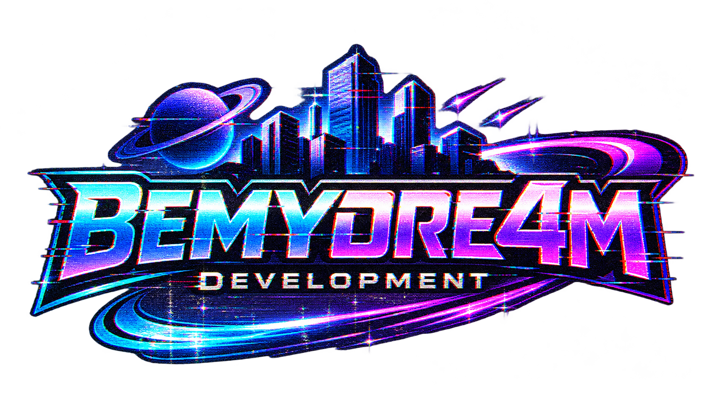
   
  <strong>Indie Game Development & GTA Modding</strong>
   
  
  by KrynxtioN 
  <a href="https://www.youtube.com/@THEREALKRYNXTION">
    https://www.youtube.com/@THEREALKRYNXTION
  </a>
  

  

  <!-- SAN ANDREAS APOCALYPSE -->

  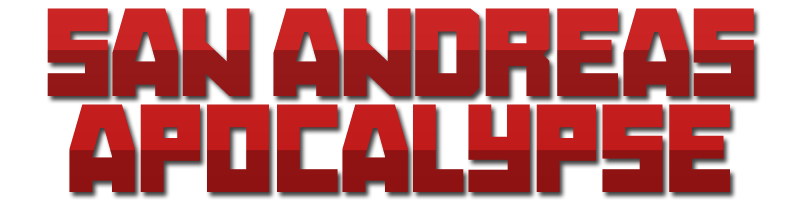
   
  <strong>A Post-Apocalyptic MMORPG in MTA:SA</strong>
   
  

  

  <!-- MY GAMES -->

  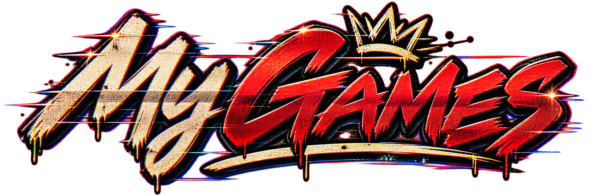
  

    <a href="https://bemydre4mdevelopment.itch.io/sir-pumpkin">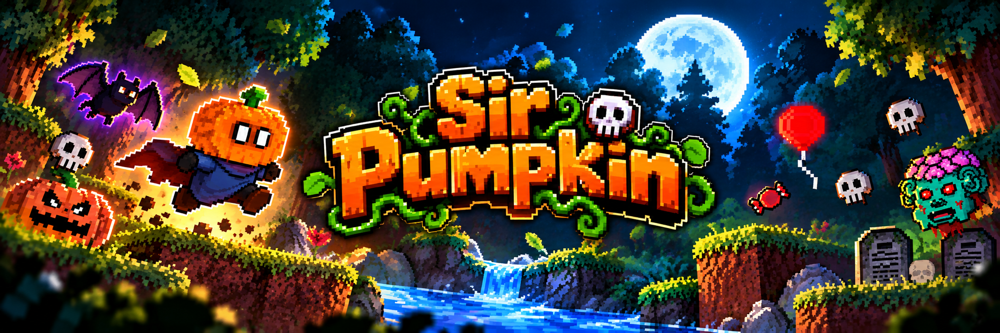</a>
  

  

  <!-- MTA GAMEMODES -->

  
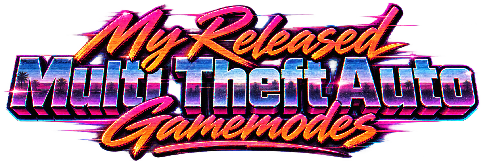

  <a href="https://github.com/KrynxtioN/Redfield-Roleplay-Remastered">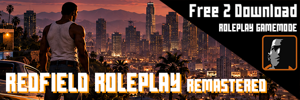</a><a href="https://github.com/KrynxtioN/Redfield-Deathmatch">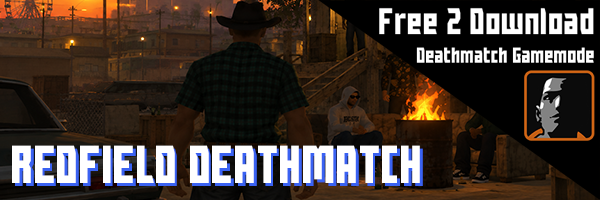</a>
   
  <a href="https://github.com/KrynxtioN/Redfield-Apocalypse">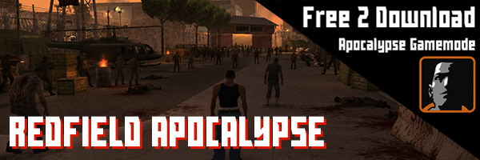</a><a href="https://github.com/KrynxtioN/Redfield-Apocalypse">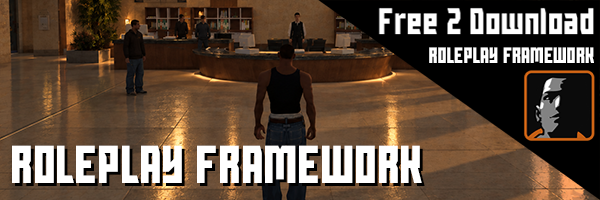</a>
   
  <a href="https://github.com/KrynxtioN/Redfield-Roleplay">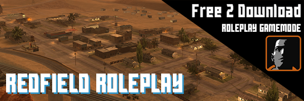</a>

  

  <!-- SOCIALS & LINKS -->

  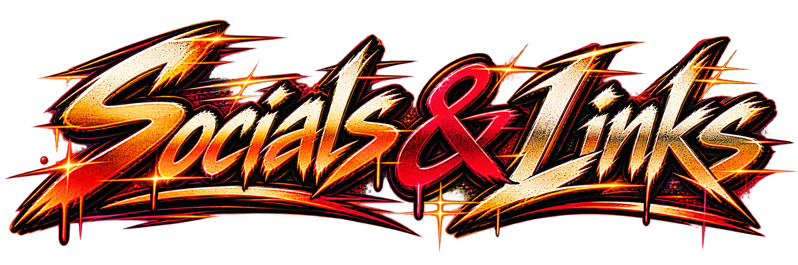

  

    
  

